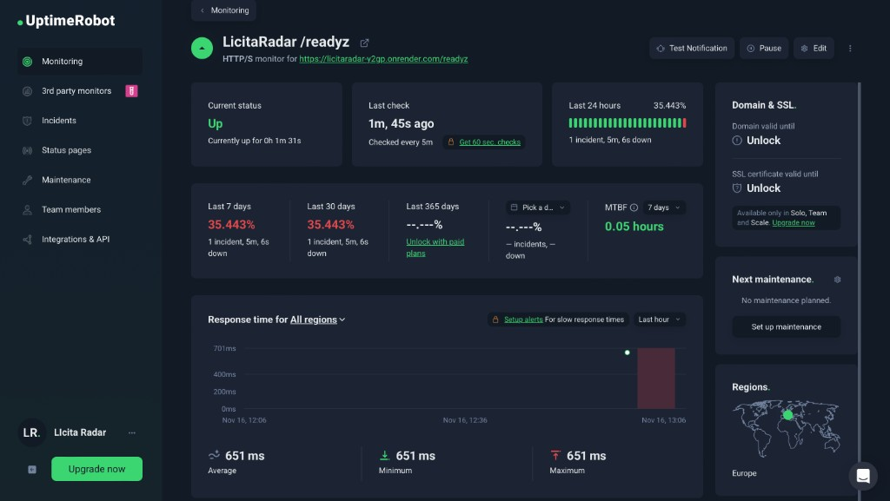
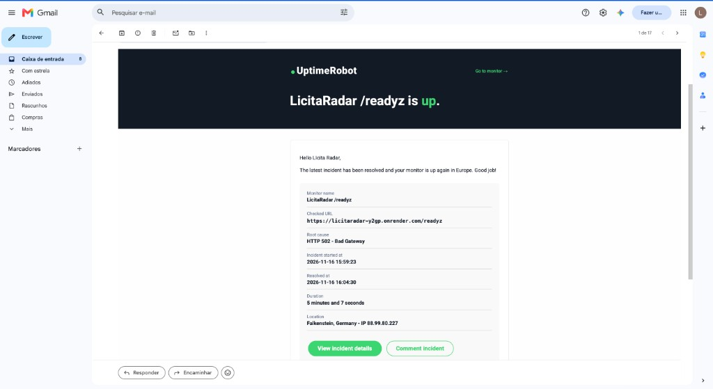
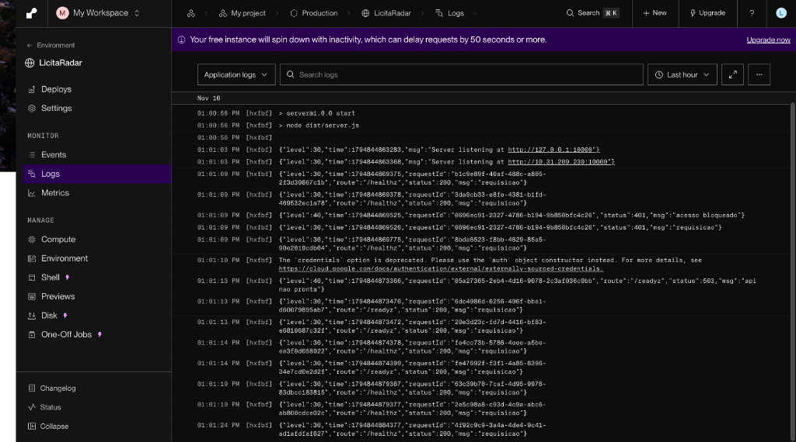
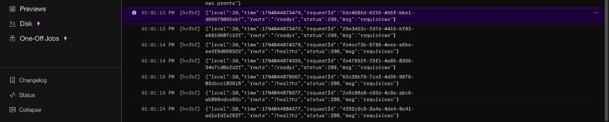

# Alertas (custo zero)

O plano gratuito não tem alerta de 5xx nem de p95 na nuvem. Os dois ficam assim:

| Pedido do caderno | O que vale neste plano |
| --- | --- |
| Alerta de 5xx | UptimeRobot no `/readyz`, a cada 5 minutos, e-mail para a equipe. Fora do ar inclui o 503 da API e o 502 do proxy enquanto o Render acorda. |
| Alerta de p95 | Teste de carga local `k6/carga.js`. Leitura com p95 até 800 ms, escrita até 1500 ms. Não roda contra o Render. |
| Falha do job de ingestão | O workflow `Ingestão PNCP` abre uma issue com o rótulo `ingestao-pncp` e o GitHub manda o e-mail a quem está atribuído. |

## `/readyz` fora do ar

Monitor HTTP(s) em `https://licitaradar-y2gp.onrender.com/readyz`, intervalo de 5 minutos, sem cartão.

A primeira checagem devolveu 502 porque a instância gratuita do Render estava dormindo. O incidente durou 5 minutos e 7 segundos. O e-mail seguinte avisou que o monitor voltou.





## Logs no Render

Cada requisição sai em JSON no stdout, e o painel **Logs** do serviço mostra essa linha. Os campos são `requestId`, `route`, `status` e `latenciaMs` (milissegundos). O corpo da resposta de erro continua só com código, mensagem e `requestId`.

O `latenciaMs` entra no processo que estiver com este código. As imagens abaixo são do painel na hora do incidente: já têm `requestId`, rota e status. A latência passa a aparecer depois que o Render publica esta versão.





## p95 no k6

Na raiz, com o Compose no ar e o seed feito:

```bash
CURTO=1 k6 run k6/carga.js
```

O script recusa URL que não seja a máquina local. Rodada curta de 16 de novembro de 2026, contra o emulador: 792 requisições, 0% de falha HTTP, checks em 100%. O maior p95 de leitura foi 46,1 ms (meta 800 ms) e o de escrita 36,8 ms (meta 1500 ms). Tabela completa em [k6-p95.md](k6-p95.md).
