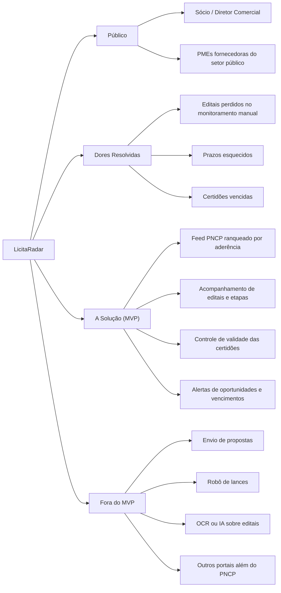

# :material-bullseye-arrow: Visão e Escopo do Produto

## :material-star-shooting: A Essência do Produto

O Propósito (Elevator Pitch) que norteia todas as decisões.

-   :material-account-group: **Para**

    ---

    PMEs fornecedoras do setor público, representadas por sócios e diretores comerciais.

-   :material-alert-circle: **Cujo problema é**

    ---

    O monitoramento manual de editais, que faz a empresa perder oportunidades e prazos, e o controle disperso de certidões, que vencem sem aviso e prejudicam a habilitação.

-   :material-radar: **O LicitaRadar é**

    ---

    Uma plataforma de monitoramento de licitações que ranqueia os editais do PNCP por aderência ao perfil da empresa, acompanha prazos e controla a documentação de habilitação.

-   :material-shield-off: **Diferente de**

    ---

    Buscas manuais no portal, planilhas de acompanhamento e agregadores genéricos de editais, que não conectam a oportunidade ao estado real da documentação da empresa.

-   :material-trophy: **Nossa Vantagem**

    ---

    Score de aderência determinístico, ingestão do PNCP sem duplicação e alertas que unem oportunidades e vencimentos de certidões em um único radar.

---

## :material-target-account: O Problema que Resolvemos

Três perdas recorrentes de quem vende para o governo e depende de acompanhar editais manualmente.

-   :material-file-search: **Oportunidades perdidas**

    ---

    O volume de publicações no PNCP torna inviável a busca manual. Editais relevantes passam despercebidos ou são descobertos perto do prazo.

-   :material-calendar-alert: **Prazos esquecidos**

    ---

    Sem um acompanhamento central, as etapas de preparação e as datas de entrega se perdem entre e-mails e planilhas.

-   :material-file-alert: **Habilitação comprometida**

    ---

    Certidões vencidas descobertas tarde demais inabilitam a empresa em licitações que ela poderia vencer.

---

## :material-sitemap: Mapa Mental de Escopo

O mapa mental consolida o foco do produto de forma visual, removendo qualquer ambiguidade do que faz parte da solução.

---

## :material-map-marker-path: O MVP em Cinco Jornadas

Do perfil da empresa ao alerta: o caminho completo que o produto precisa entregar.

-   :material-tune-variant: **1. Configurar o perfil**

    ---

    Definir termos de interesse, UFs, modalidades e faixa de valor.

-   :material-format-list-numbered: **2. Explorar o feed**

    ---

    Ver os editais ranqueados por aderência, com filtros.

-   :material-eye-check: **3. Acompanhar editais**

    ---

    Seguir um edital e as etapas de preparação até o prazo.

-   :material-file-certificate: **4. Controlar certidões**

    ---

    Monitorar a validade das certidões exigidas na habilitação.

-   :material-bell-ring: **5. Receber alertas**

    ---

    Ser avisado sobre novas oportunidades aderentes e sobre vencimentos.

---

## :material-close-circle-outline: Fora do Escopo deste MVP

Decisões conscientes para manter o foco e entregar com qualidade no ciclo.

| Não entra no MVP | Observação |
| :--- | :--- |
| Envio de propostas | O produto apoia a decisão e a preparação, não a submissão |
| Robô de lances | Fora da proposta de valor |
| OCR ou IA sobre editais | O ranqueamento é determinístico, sem análise do texto por IA |
| Outros portais além do PNCP | O PNCP é a única fonte de editais |

---

## :material-cog-outline: Desafio de Engenharia

O valor do produto depende de uma base técnica confiável.

-   :material-api: **Integração externa**

    ---

    Consumo do PNCP com tratamento de indisponibilidade e recuperação de falhas.

-   :material-table-cog: **Normalização**

    ---

    Padronização dos dados dos editais para filtros e ranqueamento consistentes.

-   :material-calculator-variant: **Score determinístico**

    ---

    A mesma entrada gera sempre a mesma pontuação, o que torna o ranking previsível e testável.

-   :material-content-duplicate: **Ingestão sem duplicação**

    ---

    Reprocessar a mesma publicação não cria registros repetidos.

---

## :material-presentation-play: Critério de Sucesso e Demonstração

Como vamos provar que o MVP funciona.

1. Dois perfis de empresa distintos recebem feeds diferentes.
2. O feed ranqueado e o controle de habilitação funcionam de ponta a ponta.
3. A **relevância dos dez primeiros resultados** é medida para cada perfil.

---

## :material-cloud-check-outline: Premissas do Ciclo

| Item | Definição |
| :--- | :--- |
| Base tecnológica | GCP + Firebase |
| Custo estimado do projeto | US$ 10–20 (estimativa de planejamento, não preço garantido) |
| Complexidade | Média-alta |
| Janela do ciclo | 04/10/2026 a 05/12/2026 |

---

## Histórico de Versões

| Versão | Data | Descrição | Autor |
| :---: | :---: | :--- | :--- |
| `1.0` | 09/10/2026 | Criação do documento | Maria Júlia Sena |